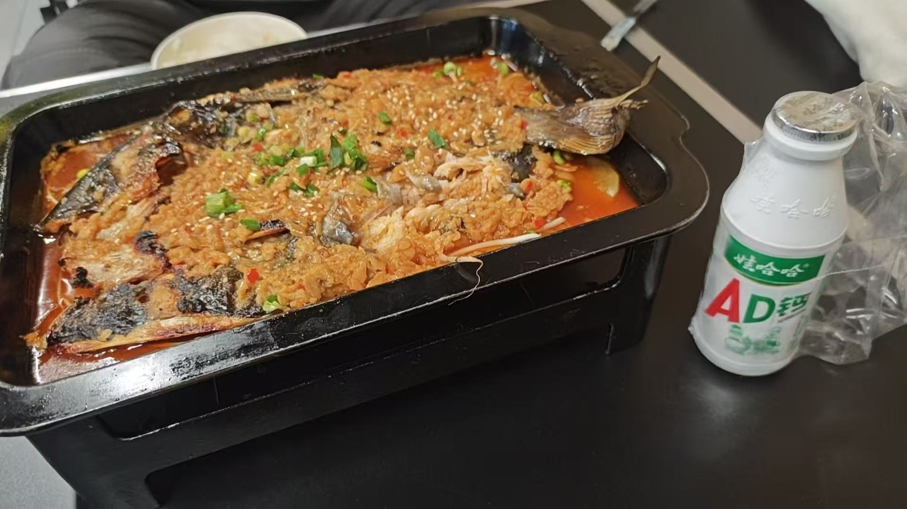

# 大学以来第一次吃到生日蛋糕

中午吃塔克星。下午杰拉电竞打游戏，绝地求狗好玩。还剩下27余额。

杰拉电竞·网咖(杭州西湖铂悦城店)浙江省杭州市西湖区留下街道景顺铂悦城

晚上阿遇烧烤好吃。-101 吃完歇了会继续吃生日蛋糕。

阿遇烧烤(西湖景顺铂悦城店)浙江省杭州市西湖区留下街道留和路景顺铂悦城

吃完烧烤和生日蛋糕出来还偶遇一辆明日方舟痛车

回wck宿舍，他向我讲解了 RSI 的对象：Harness、Model、Task，顺便了解了IDEA IED，打算下一个。

找到了博客美化的参考方案：

https://docs.mizuki.mysqil.com/
